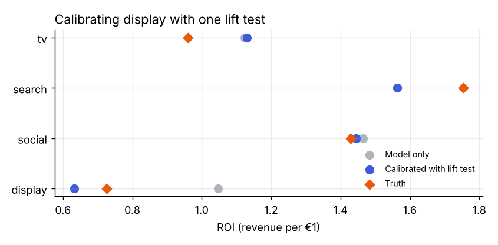
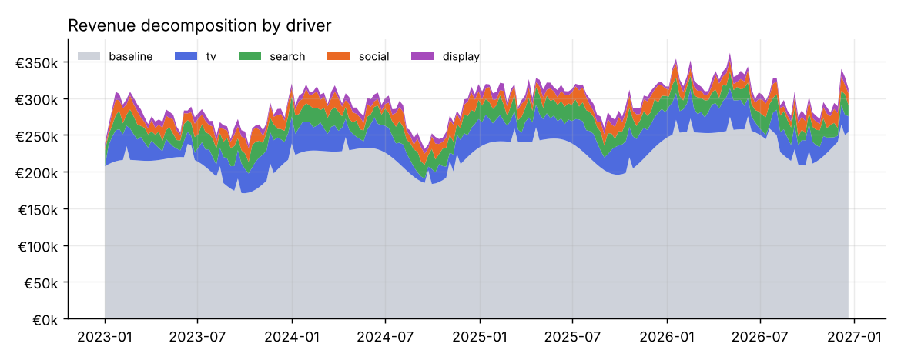
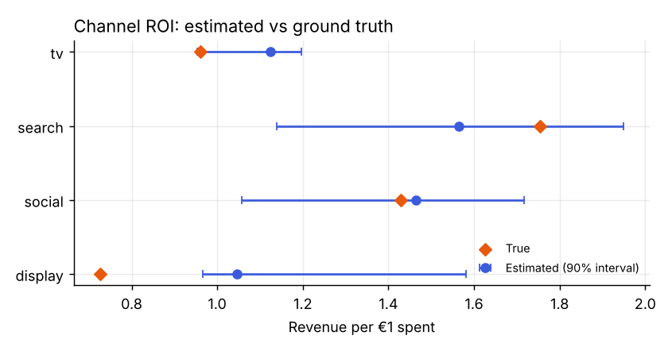
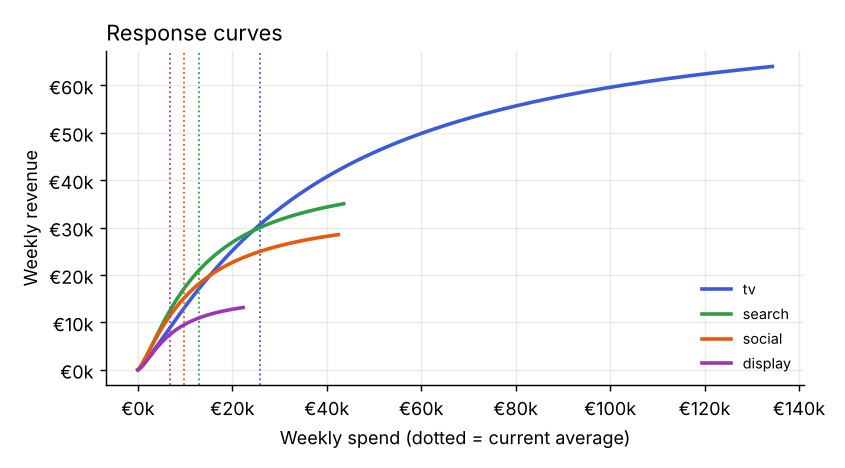

# Marketing mix modeling, end to end

[](https://github.com/filizrabia/meridian-mmm-demo/actions/workflows/ci.yml)  

A marketing mix model (MMM) built step by step on synthetic weekly data where the true channel effects are known, so every answer can be checked against the truth. It covers the full workflow: fitting, out-of-sample validation, uncertainty, calibration with a lift test, and budget reallocation. A companion script fits the same data with [Google Meridian](https://github.com/google/meridian).

**Start here:** [notebooks/mmm_walkthrough.ipynb](notebooks/mmm_walkthrough.ipynb) walks through the analysis as a story, from the business question to the budget recommendation.



## The story in four numbers

| | |
|---|---|
| **0.98** | R² of the fit, with a holdout MAPE (1.07%) close to the training MAPE (0.97%): no overfitting |
| **3 of 4** | channels whose true ROI falls inside the model's 90% interval |
| **0.32 → 0.09** | ROI error on display before and after calibrating with one lift test |
| **+0.8%** | media-driven revenue from reallocating the same budget (about €29k a year) |

The interesting part is the channel the model gets wrong. Display is the smallest channel: its effect is a few thousand euros a week on a revenue line that moves by tens of thousands, so the data alone can't separate it from the baseline. The model overstates its ROI (1.05 vs 0.73 true), with an interval that misses the truth. A single, noisy lift test fixes it, and the other channels barely move.

## What's inside

| | |
|---|---|
| `mmm/transforms.py` | Geometric adstock (carryover) and Hill saturation (diminishing returns) |
| `mmm/data.py` | Four years of weekly revenue driven by baseline, trend, seasonality, promos and four media channels |
| `mmm/model.py` | The MMM: penalized least-squares fit (a MAP estimate with weak priors), lift-test calibration, holdout fitting, block-bootstrap ROI intervals, response curves and a constrained budget optimizer |
| `meridian/fit_meridian.py` | The same dataset fitted with Meridian's Bayesian model |
| `notebooks/mmm_walkthrough.ipynb` | The full analysis with commentary |
| `run_demo.py` | Regenerates the charts and [results.md](results.md) |

## Run it

```bash
pip install -r requirements.txt
make demo        # charts + results.md
make test        # unit tests
```

The numpy model runs in seconds. For the Meridian version, `pip install google-meridian` and run `python meridian/fit_meridian.py` (several minutes of MCMC on a CPU).

## Results

The decomposition separates baseline demand from media:



Model-only ROI estimates with 90% bootstrap intervals, against the truth:



Response curves show where each channel sits on its saturation curve. Search and social still return more than €1 for the next euro at current spend; TV and display don't.



Full tables, including the budget plan, are in [results.md](results.md).

## Modeling notes

- **Adstock before saturation.** Spend is carried over first, then saturated, matching Meridian's default order.
- **Priors as penalties.** Weak penalties on decay, half-saturation (relative to average spend) and Hill slope keep the curves identifiable. Without them, saturation and scale trade off against each other.
- **Calibration as a likelihood term.** A lift test adds `(model ROI − measured ROI) / standard error` to the objective, so a precise experiment pulls hard and a noisy one barely moves the model.
- **Linear parts solved exactly.** For any guess of the media parameters, the baseline, trend, seasonality and promo coefficients are solved by least squares, so the optimizer only searches the 16 nonlinear parameters.
- **Bounded budget moves.** Each channel stays within ±50% of current spend, so recommendations stay inside the range the model has seen.

## With real data, I would also

- fit at geo level, which multiplies observations and is the biggest single gain for identification;
- run Meridian for full posteriors and set ROI priors from past experiments;
- keep a rolling plan of lift tests, starting with the channels where the model is least certain.

## License

MIT
